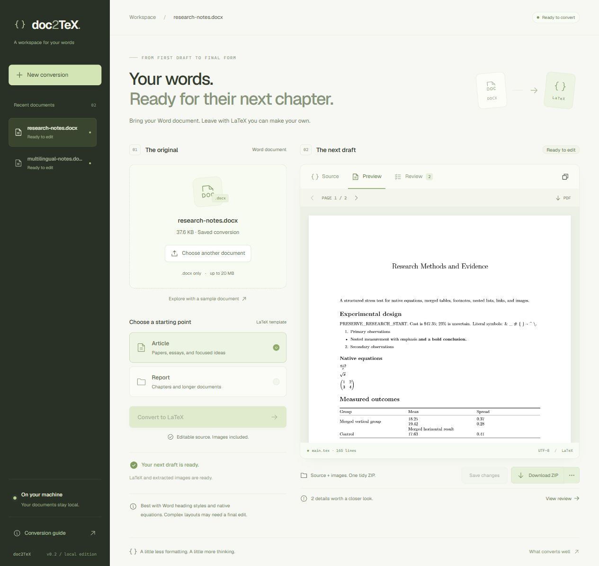
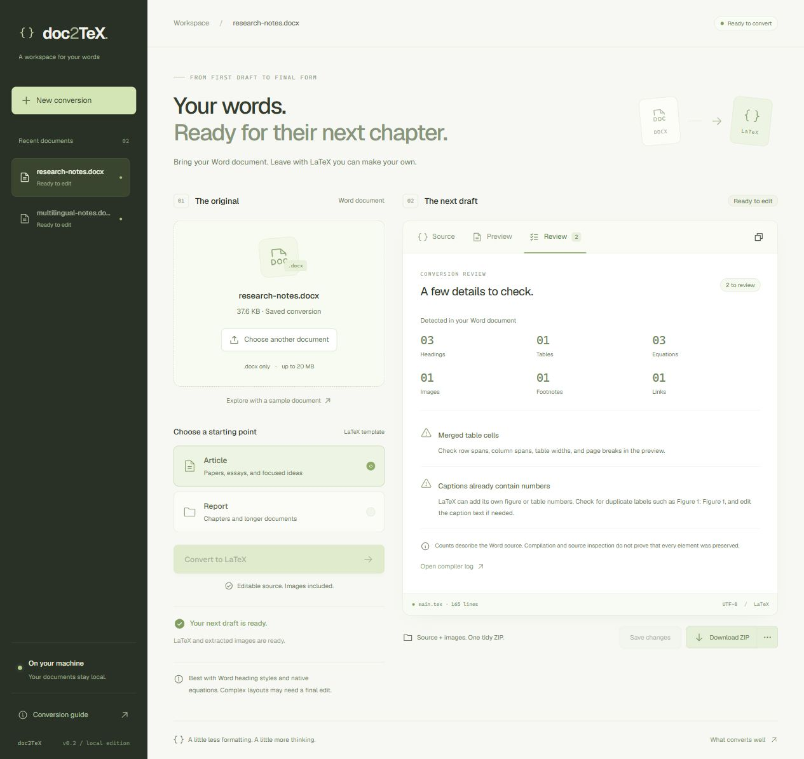

<p align="center">
  
</p>

<p align="center"><strong>Your words. Ready for their next chapter.</strong><br />A local workspace for turning Word documents into editable LaTeX.</p>

<p align="center">
  <a href="https://github.com/braces157/doc2tex/actions/workflows/ci.yml"></a>
  <a href="LICENSE"></a>
  
  
  
</p>

<p align="center"><a href="#quick-start">Get started</a> · <a href="docs/development.md">Development & API</a> · <a href="docs/conversion-test-results.md">Conversion test report</a> · <a href="CONTRIBUTING.md">Contribute</a></p>



## From DOCX to a draft you can own

Upload a document, choose Article or Report, and edit the resulting LaTeX. Build a PDF when you're ready, then take the source, images, and required fonts with you in one ZIP.

- **Structure that stays useful.** Headings, lists, tables, links, footnotes, images, and native Word equations convert through Pandoc.
- **An editor and PDF viewer together.** Save or copy source, navigate PDF pages, and download `.tex`, PDF, or a complete project ZIP.
- **Pick up unfinished edits.** Recover browser-local drafts after reopening a document, and retry source loading without risking a blank overwrite.
- **Review before you trust.** Source feature counts and warnings call out tracked changes, merged cells, headers, charts, captions, and compiler problems.
- **Multilingual exports.** Conditional Noto fonts cover the tested Latin, Vietnamese, Greek, Cyrillic, Thai, Chinese, Japanese, and Arabic samples. Font licenses travel with the export.
- **A quiet local workspace.** Documents and conversion history stay on disk. A bounded queue handles conversions in the background, with history restored after restart.
- **A considered interface.** React, TypeScript, shadcn/Radix, keyboard controls, responsive layouts, and a PDF.js canvas viewer.

<details>
<summary><strong>See the conversion review</strong></summary>



Screenshots use synthetic documents from the checked-in test corpus.
</details>

## Quick start

Install **JDK 21+**, **Node.js 24 LTS**, and Git. The Maven Wrapper is included. Allow internet access for dependency setup and the first PDF compilation.

```sh
git clone https://github.com/braces157/doc2tex.git
cd doc2tex
```

**Windows / PowerShell**

```powershell
powershell -NoProfile -ExecutionPolicy Bypass -File scripts/setup-tools.ps1
powershell -NoProfile -ExecutionPolicy Bypass -File scripts/start.ps1
```

**Linux x86-64 / macOS Intel or Apple Silicon**

```sh
bash scripts/setup-tools.sh
bash scripts/start.sh
```

Open **[127.0.0.1:8080](http://127.0.0.1:8080)**. Try **Explore with a sample document**, or upload a `.docx` up to 20 MB. Stop the server with Ctrl+C.

Setup downloads checksum-verified Pandoc 3.12.1, Tectonic 0.17.0, and pinned Noto fonts into `.tools/`. Tectonic fetches TeX packages on the first PDF build; later builds use its cache. Conversion does not require a PDF build. macOS setup is provided, while automated CI covers Windows and Linux.

If your ZIP contains `fonts/`, select **XeLaTeX** when opening it in Overleaf or another LaTeX editor.

## Tested on difficult documents

The regression corpus includes real DOCX files with native math, merged tables, multilingual text, revisions, and long tables. CI installs the actual converters and runs the PDF suite on Java 21 on both Windows and Linux; it fails if any tests are skipped.

| Fixture | What it exercises |
|---|---|
| Research methods | Fraction, radical, matrix, footnote, nested lists, merged cells, embedded image |
| Multilingual notes | Eight language samples, Unicode source, conditional fonts, missing-glyph checks |
| Edited operations | Accepted/deleted revisions, headers/footers, text box, chart, comments |
| Observation register | 40 sections, 90-row table, repeated headers, final-page checkpoint |

See the [measured results, visual verification, and remaining limits](docs/conversion-test-results.md). PDF compilation alone does not prove a faithful conversion.

## Scope and limits

**This is a single-user local application.** It binds to loopback by default and checks local hosts/origins. It does not provide accounts, an OS worker sandbox, or a public upload service. See the [security model](SECURITY.md) before changing deployment assumptions.

**DOCX is the supported input.** PDF, scanned documents, legacy `.doc`, and Google Docs links are not supported. Conversion preserves structure; exact Word pagination, editable charts, headers/footers, comments, complex tables, bidirectional layout, and unusual scripts can require manual work. Tracked changes are accepted. Review the generated source and PDF before sharing them.

## Build and develop

```sh
npm --prefix frontend ci
npm --prefix frontend run lint
npm --prefix frontend run build
./mvnw verify -Ddoc2tex.test-pdf=true
java -jar target/doc2tex-0.1.0.jar
```

On Windows use `./mvnw.cmd verify '-Ddoc2tex.test-pdf=true'`. The full suite needs the setup tools and fonts. For a fast backend run without PDF compilation, omit the property.

The packaged JAR serves the built frontend. For hot reload, run `./mvnw spring-boot:run` and `npm --prefix frontend run dev` in separate terminals, then open port 5173.

```text
frontend/                         React workspace and shadcn components
src/main/java/dev/doc2tex/         API, queue, validation, converter workers
src/test/resources/corpus/         Synthetic DOCX regression fixtures
scripts/                          Tool setup and corpus verification
logs and originals live in .data/ (Git-ignored)
downloaded tools live in .tools/  (Git-ignored)
```

Read the [development guide](docs/development.md) for API routes, settings, persistence, and verification commands. Contributions are welcome; start with [CONTRIBUTING.md](CONTRIBUTING.md).

## License

Original project code is [MIT licensed](LICENSE). Dependencies, external converters, and fonts retain their own licenses; see [third-party notices](THIRD_PARTY_NOTICES.md).
